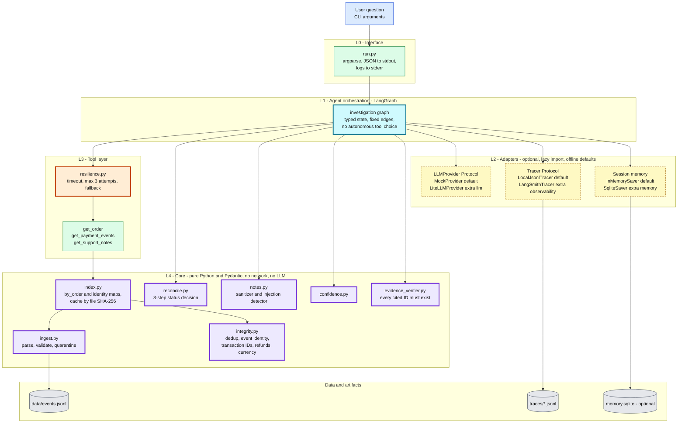
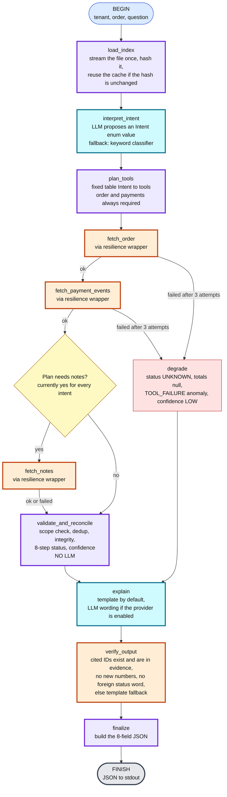
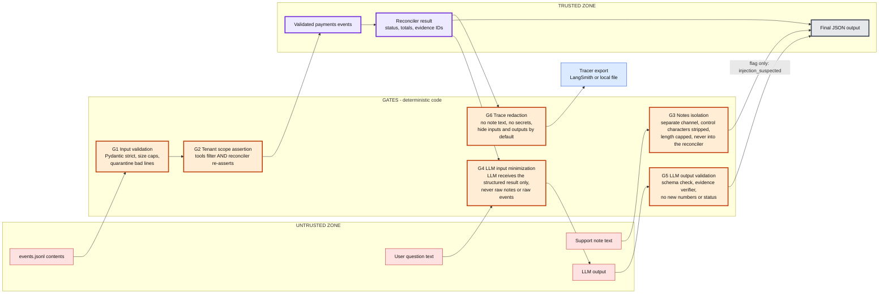
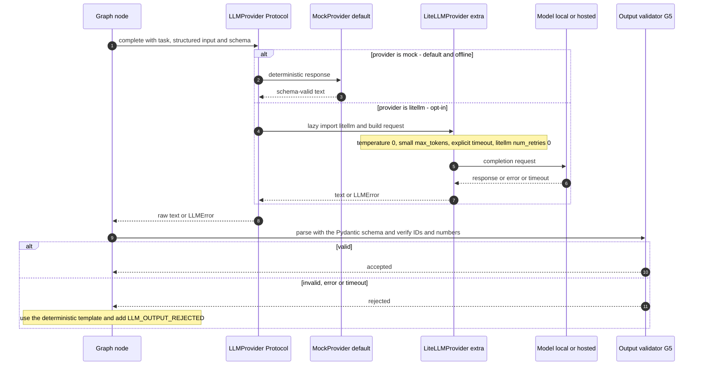
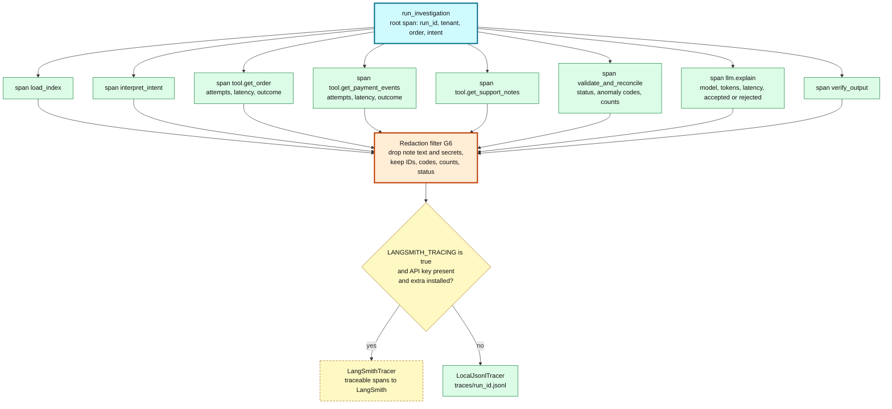
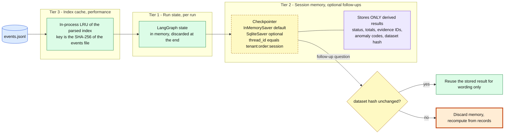

# TraceGuard - Production Agentic Architecture

**Document 2 of 3.** Read this together with `TraceGuard_PRD.md` (Document 0, start there) and `TraceGuard_DataFlow.md` (Document 1).

| | |
|---|---|
| **Purpose** | Defines HOW the system is built: tech stack, layers, module layout, agent graph, security gates, LLM adapter, observability, memory, dependency policy, tests and build order. |
| **Audience** | A coding agent implementing TraceGuard, and the human reviewer. |
| **Authority** | This document is the single source of truth for **structure, stack, security, observability and memory**. `TraceGuard_DataFlow.md` is the single source of truth for **business rules** (validation, dedup, integrity, 8-step status decision, anomaly codes, confidence, expected results). `TraceGuard_PRD.md` is the single source of truth for **scope, priorities, deliverables and acceptance criteria** and adds no structure or business rules. If they conflict on a business rule, Document 1 wins. |
| **Keywords** | MUST / MUST NOT / SHOULD are normative. |

---

## 0. Read this first (summary for the coding agent)

1. Build a **deterministic core** (pure Python + Pydantic) that decides all financial truth. It has no network access and no LLM code.
2. Wrap it in a **fixed LangGraph state machine**. The graph calls three tools through one bounded-retry wrapper, runs the core, then explains the result.
3. The LLM has **exactly two optional jobs**: label the question with a value from a closed enum, and rephrase the explanation. Both have deterministic fallbacks. The financial result is computed **before** any LLM call.
4. **LiteLLM** (provider abstraction) and **LangSmith** (observability) are **optional extras** with offline defaults (mock LLM, local JSONL tracer). The project MUST run, and all tests MUST pass, with no credentials and no network.
5. Support notes are untrusted. They are isolated, never reach the reconciler, never appear as evidence, and are never sent raw to an LLM.
6. Do not add frameworks that are not listed in Section 2. Do not give the LLM control over tools, edges, status or numbers.
7. Build in the order of Section 16 and keep each step green before moving on.

### Why an "agentic stack" at all, given the brief?

The assessment forbids an LLM from being the source of financial truth, requires the project to run without paid APIs, and says a smaller correct solution beats an elaborate agent. This design respects that: the agent layer adds **orchestration, observability, provider abstraction and safe memory** around a deterministic core. It does not add autonomy.

---

## 1. Non-negotiable constraints (from the assignment)

| # | Constraint | Architectural consequence |
|---|---|---|
| K1 | Python 3.11+ | `requires-python = ">=3.11"` |
| K2 | Financial truth comes from validated records and deterministic rules, never an LLM | `core/` has zero LLM imports. Reconciliation completes before any LLM call. |
| K3 | Must run without paid APIs or credentials | Defaults: `MockProvider`, `LocalJsonlTracer`, in-memory state. Real providers are opt-in extras. |
| K4 | LLM integration must be replaceable | `LLMProvider` Protocol. LiteLLM is one implementation, not a core dependency. |
| K5 | Three tools: `get_order`, `get_payment_events`, `get_support_notes` | Implemented in `tools/`, always called through the resilience wrapper. |
| K6 | Bounded retry, clear fallback, tool timeouts | One retry policy in `resilience.py`: max 3 attempts, per-attempt timeout. |
| K7 | Support notes are untrusted (prompt injection) | Isolated channel, never in the reconciler, never evidence, never raw into prompts. |
| K8 | Evidence IDs must exist in the input | `core/evidence_verifier.py` runs on every output. |
| K9 | CLI prints exactly the 8-field JSON object | stdout is JSON only. Logs and run IDs go to stderr. |
| K10 | Small, correct, testable beats large and unvalidated | LLM has 2 optional roles. Graph has fixed edges. No autonomous tool choice. |

---

## 2. Tech stack (all Python)

"Core" = always installed. "Extra" = optional, imported lazily, never required by the CLI or tests.

| Concern | Choice | Mode | Why this choice |
|---|---|---|---|
| Language | Python 3.11+ | core | Required by the brief |
| Environment and lockfile | **uv** with a hashed `uv.lock` | tooling | Reproducible installs. The lockfile pins exact versions and protects against a bad upstream release. |
| Models and validation | **Pydantic v2**, strict mode | core | Typed events, `ReconResult`, `Intent`, LLM output schemas. Fails closed on wrong types (`float` or `bool` as `amount_cents`). |
| Agent orchestration | **LangGraph** `StateGraph` | core | Typed state, explicit nodes and edges, conditional routing, optional checkpointing, native LangSmith tracing. A fixed graph is deterministic and explainable. |
| LLM provider abstraction | **LiteLLM SDK** behind the `LLMProvider` Protocol | **extra `llm`** | One interface for many providers, including free local models. SDK only, never the proxy server. See Section 11. |
| Default LLM | `MockProvider` | core | Satisfies K3. Used in all tests. |
| Observability | **LangSmith** (`langsmith`, `@traceable`) behind the `Tracer` Protocol | **extra `observability`** | Traces every node, tool call and LLM call. Off unless enabled and a key exists. |
| Default tracer | `LocalJsonlTracer` writing `traces/<run_id>.jsonl` | core | Observability works offline with the same span schema. |
| Session memory | LangGraph `InMemorySaver` (default), `SqliteSaver` (optional) | core / extra `memory` | Follow-up questions. Stores derived results only. |
| Index and cache | In-process dict index plus LRU, keyed by SHA-256 of the events file | core | One streaming pass, O(1) lookups per `(tenant, order)`. |
| Retry and timeout | Small hand-written wrapper (about 30 lines) | core | Easy to explain in the technical review. One policy in one place. No extra dependency. |
| CLI | stdlib `argparse` | core | Zero dependency |
| Logging | stdlib `logging` with a JSON formatter, to stderr | core | Fewer dependencies means less attack surface |
| Tests | `pytest`, **`hypothesis`**, `pytest-cov` | dev | Property-based and metamorphic tests are required |
| Quality gates | `ruff`, `mypy`, `pip-audit`, `gitleaks` (pre-commit) | dev | Lint, types, known-vulnerability scan, secret scan |

### Deliberately NOT used

| Rejected | Reason |
|---|---|
| LangChain `AgentExecutor`, CrewAI, AutoGen, free-form ReAct loops | An LLM choosing tools freely is non-deterministic. Violates K2 and K10. |
| LiteLLM **proxy server** or the `litellm/litellm` Docker images | Larger attack surface. A library call is enough. |
| Vector database, RAG, embeddings | There is no retrieval problem. Evidence lookup is exact-ID. |
| Redis, Postgres, Kafka | Out of scope for the take-home. Mentioned only as the scale path (`DECISIONS.md`, question 6). |
| Third-party guardrail frameworks | Our guardrails are deterministic code (schema validation plus evidence verifier). Easier to test and explain. |
| `async` everywhere | No real concurrency need. Synchronous code with thread-based timeouts is simpler. |

---

## 3. System architecture (layers)

**Dependency rule:** arrows point **downward only**. `core/` MUST NOT import from `tools/`, `agent/`, `adapters/` or `run.py`. Optional packages (`litellm`, `langsmith`, sqlite saver) MUST be imported lazily inside their adapter class, never at module top level.



Reading guide: dashed yellow boxes are optional adapters with offline defaults. Purple boxes are the deterministic core that decides all financial truth. Orange boxes are protection points.

---

## 4. Runtime flow (LangGraph state machine)

The graph is **fixed**. The LLM can influence only two things: which label from a closed `Intent` enum the question gets, and the wording of the explanation. Both have deterministic fallbacks. The tool plan is a **lookup table**, not an LLM decision.



Graph rules:

1. `validate_and_reconcile` MUST complete before `explain` runs. The LLM never sees a partial result.
2. If `fetch_notes` fails, status is unaffected (notes are not evidence). Add `NOTES_UNAVAILABLE` (INFO). Confidence is capped at `MEDIUM`.
3. `degrade` still passes through `explain` and `verify_output`, so failure output has a real explanation and valid (possibly empty) evidence IDs.
4. Nodes MUST NOT call tools that belong to other nodes. No loops. No LLM-chosen edges.
5. The graph is compiled with a checkpointer only when `TRACEGUARD_MEMORY` is not `off`; then every invocation passes a `thread_id` of the form `tenant:order:session`.

### 4.1 Intent to tool plan (fixed table)

| Intent (closed enum) | Example question | `get_order` | `get_payment_events` | `get_support_notes` |
|---|---|---|---|---|
| `IS_PAID` | "Was this order paid?" | yes | yes | yes (for injection reporting) |
| `WHY_FAILURE` | "Why does checkout show a failure?" | yes | yes | yes |
| `EVIDENCE_SUPPORT` | "What evidence supports the current status?" | yes | yes | yes (for injection reporting) |
| `GENERAL_STATUS` | anything else or unparseable | yes | yes | yes |

Order and payments are **always** called, because the status cannot be computed without them.

Notes are also fetched for **every** current intent (decision A16 in the PRD). Reason: the injection warning and the `MEDIUM` confidence cap must never depend on how the question is worded, and an investigator who asks for evidence must not be shown a cleaner picture than one who asks if the order was paid. The graph still reads this table (so a future intent could skip notes), but today every row says yes. Consequence: in default mode (mock or no LLM) all 8 output fields are identical for every question about the same `(tenant, order)`.

### 4.2 Keyword intent classifier (deterministic fallback)

Lowercase the question, then apply in this order: contains `evidence`, `support`, `proof` or `cite` gives `EVIDENCE_SUPPORT`; else contains `fail` or starts with `why` gives `WHY_FAILURE`; else contains `paid`, `payment`, `pay`, `refund` or `status` gives `IS_PAID`; else `GENERAL_STATUS`. Any invalid LLM intent output MUST map to `GENERAL_STATUS`, never raise.

---

## 5. Trust boundaries and security gates

Every arrow that crosses a zone passes through a numbered gate. **Each gate MUST have at least one test.**



### Security requirements

| ID | Requirement | Where enforced |
|---|---|---|
| S1 | Strict typing: `amount_cents` MUST be a real `int` (reject `float`, `str`, `bool`). Timestamps MUST parse as ISO 8601. | `core/ingest.py` |
| S2 | Input caps: maximum line length (for example 64 KB), maximum events per file (configurable), maximum note length | `core/ingest.py` |
| S3 | `--events` handled with `pathlib`, must be a regular file. No shell execution anywhere. | `run.py` |
| S4 | Tenant isolation: key is `(tenant_id, order_id)`. Tools filter, the reconciler asserts again, memory `thread_id` includes the tenant. | `core/index.py`, `core/reconcile.py`, `adapters/memory.py` |
| S5 | Notes never enter the reconciler, the evidence list, totals, or raw LLM prompts. The only effect is the documented confidence cap and the warning sentence. | `core/notes.py`, graph wiring |
| S6 | LLM prompts are built from a **structured template** filled from `ReconResult`. The user question is passed as a quoted data field, never concatenated into instructions. | `agent/prompts.py` |
| S7 | LLM output is parsed through a Pydantic schema. Anything invalid is discarded and the template is used. | `agent/explain.py` |
| S8 | Secrets only through environment variables. `.env` is git-ignored. `.env.example` has placeholders only. Keys are never logged or traced. | `config.py`, `.gitignore`, gitleaks |
| S9 | Tests MUST NOT use the network. A fixture blocks sockets. | `tests/conftest.py` |
| S10 | Dependency hygiene: hashed lockfile, exact pins for optional LLM and observability packages, `pip-audit` in the dev workflow (Section 11). | `pyproject.toml`, `uv.lock` |
| S11 | Trace redaction: raw note text and API keys MUST NOT appear in any trace. LangSmith hide-inputs and hide-outputs are on by default, and masking also happens at our own boundary. | `adapters/tracing.py` |

---

## 6. LLM layer (LiteLLM behind a Protocol)



### Interface (keep these names)

```python
class LLMProvider(Protocol):
    def complete(self, task: str, payload: dict, schema: type[BaseModel]) -> BaseModel:
        """Return an instance of `schema` or raise LLMError. Never return free text."""

class LLMError(Exception): ...
```

### Requirements

1. `MockProvider` MUST be deterministic and MUST offer a **misbehaving mode** for tests (wrong status, invented event IDs, injected text) to prove G5 rejects it.
2. `LiteLLMProvider` MUST:
   - import `litellm` lazily inside `__init__`, never at module top level;
   - use the **SDK only** (`litellm.completion`), never `litellm.proxy`, any proxy server, or Docker image;
   - set `temperature=0`, a small `max_tokens`, an explicit `timeout`, and `num_retries=0` (our wrapper owns retries: max 2 attempts for LLM calls);
   - NOT enable LiteLLM success or failure callbacks that send data to third parties. Observability goes only through our `Tracer`.
3. At most **2 LLM calls per run** (intent, explanation). Both optional.
4. Provider selection: `TRACEGUARD_LLM_PROVIDER=mock|litellm` (default `mock`). If `litellm` is selected but not installed, or the adapter was not built (tier P2), raise a controlled error, log to stderr, and fall back to the mock provider.
5. Prompts contain only structured result fields (status, totals, evidence IDs, anomaly codes, counts). **Never** raw note text or raw event records.

---

## 7. Observability (LangSmith plus local fallback)



### Interface (keep these names)

```python
class Tracer(Protocol):
    def span(self, name: str, **attrs) -> ContextManager["Span"]: ...
    def event(self, name: str, **attrs) -> None: ...
```

### Requirements

1. Both tracers implement the same `Tracer` Protocol and emit the **same span schema**. Switching is configuration only.
2. Tracing MUST NOT change results. A tracer failure (network down, bad key) MUST be swallowed, logged to stderr, and the run continues. The financial output is identical with tracing on or off.
3. Business data sent to a third-party SaaS is a risk. Default: hide inputs and outputs, send only IDs, codes, counts and status. Never send note `text` or raw event payloads.
4. Each run has a `run_id` (UUID4) printed to **stderr**, never stdout.
5. Optional: `scripts/trace_summary.py` reads `traces/*.jsonl` and prints a table (useful for the demo video without LangSmith credentials).

---

## 8. Memory and caching

"Memory" is deliberately small. **Memory is never evidence.**



Rules:

1. Memory MUST NOT store raw note text, raw LLM output, or user free text beyond the question string.
2. Entries are keyed by tenant. A lookup MUST NOT cross tenants (test it).
3. A stored result is reused only if the dataset hash matches. Otherwise recompute from records.
4. Memory MUST NOT influence status or totals. It may only speed up wording for a follow-up such as "What evidence supports this?".
5. The CLI works with memory off (single-shot). Memory is demonstrated, not required.

---

## 9. Optimization (what to implement and what to skip)

| Area | Implement | Skip |
|---|---|---|
| Parsing | Stream the file line by line in one pass. Build `dict[(tenant, order)] -> list[Event]` plus the identity maps from Document 1, Section 6. | Loading everything into pandas |
| Lookup | O(1) index lookup per tool call | Re-scanning the file per tool call |
| Reconcile | Work per order only: O(k) for k events of that order | Global joins |
| Cache | SHA-256 of the file (streamed) as the cache key | Time-based expiry |
| LLM cost and latency | Compute the financial result first. At most 2 optional LLM calls, `temperature=0`, small `max_tokens`, hard timeout | Long prompts, streaming, multi-step agents |
| Determinism | Sort events by `event_id` only for output ordering. Decisions use set logic, never timestamps. | Using timestamps to decide state |
| Scale path (documentation only) | SQLite or DuckDB index, then Postgres. Kafka ingestion. Per-tenant partitioning. Async tool layer. | Do not build this now |

---

## 10. Repository layout (final)

```
traceguard/
├── run.py                      # CLI entrypoint (thin): parse args, call agent, print JSON
├── pyproject.toml              # core deps + extras: llm, observability, memory, dev
├── uv.lock                     # hashed lockfile (commit it)
├── .env.example                # placeholders only
├── .gitignore                  # .env, traces/, *.sqlite, .venv
├── README.md                   # setup, run, confidence definition, assumptions, one real failing test
├── DECISIONS.md                # 7 answers, written by the candidate in their own words
├── AI_USAGE.md                 # written by the candidate
├── docs/DEV_LOG.md             # honest running log of failures, root causes, fixes, wrong AI suggestions
├── docs/OPEN_QUESTIONS.md      # anything the documents left unclear, with the conservative choice made
├── data/events.jsonl           # 100+ events incl. hard cases (see Document 1, Section 17)
├── scripts/trace_summary.py    # optional
├── src/traceguard/
│   ├── config.py               # env parsing (provider, model, timeouts, tracing, memory)
│   ├── models.py               # Pydantic: events, ToolResponse, ReconResult, Intent, ExplainOutput
│   ├── core/                   # PURE: no network, no LLM, no optional deps
│   │   ├── ingest.py           # parse, validate, quarantine
│   │   ├── index.py            # by_order + identity maps + file-hash cache
│   │   ├── integrity.py        # dedup, event identity, transaction IDs, refunds, currency
│   │   ├── reconcile.py        # 8-step status decision, totals
│   │   ├── notes.py            # sanitizer + injection detector
│   │   ├── confidence.py       # HIGH / MEDIUM / LOW
│   │   └── evidence_verifier.py
│   ├── tools/
│   │   ├── tools.py            # get_order, get_payment_events, get_support_notes
│   │   ├── resilience.py       # timeout, max 3 attempts, backoff, fallback result
│   │   └── faults.py           # fault injection for tests and the demo
│   ├── agent/
│   │   ├── graph.py            # LangGraph StateGraph (Section 4)
│   │   ├── state.py            # typed GraphState
│   │   ├── intent.py           # keyword classifier + LLM-assisted intent (closed enum)
│   │   ├── explain.py          # template explainer + LLM wording + G5 validation
│   │   └── prompts.py          # structured prompt templates (S6)
│   └── adapters/
│       ├── llm_base.py         # LLMProvider Protocol, LLMError
│       ├── llm_mock.py         # MockProvider (+ misbehaving mode)
│       ├── llm_litellm.py      # LiteLLMProvider (lazy import)
│       ├── tracing.py          # Tracer Protocol, LocalJsonlTracer, LangSmithTracer (lazy), redaction
│       └── memory.py           # checkpointer factory (in-memory or sqlite)
└── tests/
    ├── conftest.py             # blocks network, fixtures, event builders
    ├── test_core_*.py
    ├── test_tools_resilience.py
    ├── test_graph_*.py
    ├── test_adapters_*.py
    ├── test_architecture_imports.py
    └── test_properties.py      # Hypothesis
```

### Import rules (enforce with a test)

| Module | May import | MUST NOT import |
|---|---|---|
| `core/*` | stdlib, `pydantic`, `traceguard.models` | `agent`, `tools`, `adapters`, `langgraph`, `litellm`, `langsmith` |
| `tools/*` | `core`, stdlib | `agent`, `adapters` (except Protocols), `litellm`, `langsmith` |
| `agent/*` | `core`, `tools`, `adapters` (Protocols), `langgraph` | `litellm`, `langsmith` directly |
| `adapters/*` | `core` (models only), their own optional library (lazily) | `agent` |

`test_architecture_imports.py` SHOULD parse imports with `ast` and fail if these rules are broken.

---

## 11. Supply-chain security (important)

LiteLLM is requested for provider abstraction, but its PyPI releases were compromised **twice in 2026**. Facts verified on 7 November 2026:

| Date | Compromised versions | Last known-safe pin |
|---|---|---|
| 24 March 2026 | `1.82.7`, `1.82.8` | `1.82.6` or earlier |
| 21 October 2026 | `1.107.0` (PyPI wheels, plus Docker tags `latest`, `main-latest`, `main-stable`) | `1.106.2` |

Therefore:

1. `litellm` MUST be an **optional extra** (`.[llm]`), never a core dependency. The CLI, the graph and all tests MUST work without it installed.
2. Pin exactly: `litellm==1.106.2` in the extra. **Before building, re-check PyPI and osv.dev for newer advisories.** Do not move to a release newer than the pin unless it is verified clean and is at least 14 days old.
3. Commit `uv.lock` (hashed). Install with `uv sync` so the lockfile decides versions, not whatever PyPI serves today.
4. Never use floating Docker tags. If a container is ever used, pin by digest.
5. Create the virtual environment fresh. Never install into an environment that may have had `litellm` `1.82.7`, `1.82.8` or `1.107.0`.
6. Run `pip-audit` in the dev workflow and fail on known vulnerabilities.
7. Keep every dependency justified. This is why logging, retry and CLI use the standard library.
8. The same rule (exact versions in `uv.lock`, prefer releases at least 14 days old) applies to `langgraph`, `langsmith`, `pydantic` and checkpoint packages.

### `pyproject.toml` shape (versions resolved and locked at build time)

```toml
[project]
name = "traceguard"
requires-python = ">=3.11"
dependencies = [
  "pydantic>=2",
  "langgraph",            # exact version comes from uv.lock
]

[project.optional-dependencies]
llm           = ["litellm==1.106.2"]
observability = ["langsmith"]
memory        = ["langgraph-checkpoint-sqlite"]
dev           = ["pytest", "hypothesis", "pytest-cov", "ruff", "mypy", "pip-audit"]
```

If an optional adapter is not built (tier P2 in Section 16), omit its extra from `pyproject.toml` entirely. In particular, if `LiteLLMProvider` is not built there is no `llm` extra and no `litellm` pin, and the supply-chain rules above are satisfied trivially.

### Exact commands (put these in the README)

```bash
# default: offline, no credentials
uv sync --extra dev
uv run pytest
uv run python run.py --events data/events.jsonl --tenant T1 --order O-201 --question "Was this order paid?"

# optional extras
uv sync --extra dev --extra llm --extra observability --extra memory

# without uv
python -m venv .venv && source .venv/bin/activate
pip install -e ".[dev]"
python run.py --events data/events.jsonl --tenant T1 --order O-201 --question "Was this order paid?"
```

---

## 12. Configuration (environment variables)

All have safe offline defaults. Nothing is required to run. Variables that belong to a P2 adapter that was not built may be omitted from `config.py` and `.env.example`.

| Variable | Default | Meaning |
|---|---|---|
| `TRACEGUARD_LLM_PROVIDER` | `mock` | `mock` or `litellm` |
| `TRACEGUARD_LLM_MODEL` | none | LiteLLM model string (for example a local Ollama model). Read only when the provider is `litellm`. |
| `TRACEGUARD_LLM_TIMEOUT_S` | `10` | Per LLM call timeout |
| `TRACEGUARD_LLM_MAX_ATTEMPTS` | `2` | Bounded attempts for LLM calls |
| `TRACEGUARD_TOOL_TIMEOUT_S` | `2` | Per tool attempt timeout |
| `TRACEGUARD_TOOL_MAX_ATTEMPTS` | `3` | Bounded attempts for tools (hard cap 3) |
| `TRACEGUARD_TOOL_BACKOFF_S` | `0.1` | Base backoff (doubles each retry). Tests set it to `0`. |
| `TRACEGUARD_FAULTS` | unset | Fault-injection script for the demo, for example `get_payment_events=fail,timeout,ok`. Read only in `config.py`. Never changes the CLI options or the stdout contract. Retry attempts are logged to stderr. |
| `TRACEGUARD_MEMORY` | `off` | `off`, `memory`, `sqlite` |
| `TRACEGUARD_TRACE_DIR` | `./traces` | Local tracer output directory |
| `LANGSMITH_TRACING` | `false` | Enable LangSmith export |
| `LANGSMITH_API_KEY` | none | Used only when tracing is on |
| `LANGSMITH_PROJECT` | `traceguard` | Project name |
| `LANGSMITH_HIDE_INPUTS` / `LANGSMITH_HIDE_OUTPUTS` | `true` | Keep payloads out of SaaS traces |

---

## 13. Contracts (keep these exact)

### 13.1 CLI output (stdout: exactly these 8 fields, nothing else)

```json
{
  "status": "PAID",
  "captured_cents": 12900,
  "refunded_cents": 0,
  "net_paid_cents": 12900,
  "anomalies": [],
  "evidence_event_ids": ["order-1", "pay-1", "pay-2"],
  "explanation": "Order expected 12900 USD [order-1]. Attempt A1 failed [pay-1]. Attempt A2 captured 12900 [pay-2]. 1 duplicate event was ignored. Net paid is 12900.",
  "confidence": "HIGH"
}
```

- Totals are `null` when they cannot be established reliably (never `0` as a stand-in). Exact rules: Document 1, Section 8.2.
- `evidence_event_ids` contains only IDs that exist in the input. **Never note IDs.** Exact rules: Document 1, Section 8.3.
- `anomalies` use the string format and codes in Document 1, Sections 8.4 and 13.
- Extra diagnostics (`run_id`, quarantine counts by reason, injection detail) go to **stderr or traces**, never stdout. The injection warning also appears as a sentence inside `explanation`.
- Exit code `0` for any produced result (including `UNKNOWN`). Non-zero only for unusable invocation (for example the events file does not exist), with a clear message on stderr and no stack trace.

### 13.2 Graph state (sketch: names may change, semantics MUST NOT)

```python
class GraphState(TypedDict, total=False):
    tenant_id: str
    order_id: str
    question: str
    intent: Intent                  # closed enum
    order_response: ToolResponse    # from get_order
    payment_response: ToolResponse  # from get_payment_events
    notes: NotesChannel             # isolated: count, injection_suspected, note_event_ids
    tool_meta: dict[str, ToolMeta]  # attempts and outcome per tool
    result: ReconResult             # produced by core only
    explanation: str
    anomalies: list[str]
```

### 13.3 Confidence

Defined once, in Document 1, Section 12. Do not redefine it here. `core/confidence.py` is the only place it is computed.

---

## 14. What changed compared with the first TraceGuard design

| Area | First design | This design |
|---|---|---|
| Business rules, statuses, anomalies, corrections C1 to C15 | defined | **unchanged** (clarified in Document 1) |
| Orchestration | plain `workflow.py` | LangGraph `StateGraph`; the same stages become nodes |
| LLM | `Protocol` plus mock | Same Protocol, plus optional `LiteLLMProvider` |
| Observability | not specified | `Tracer` Protocol: local JSONL default, LangSmith optional |
| Memory | not specified | Three tiers, derived data only, tenant-scoped, hash-validated |
| Security | notes isolation and verifier | Six explicit gates (G1 to G6), requirements S1 to S11, supply-chain policy |
| Intent | keyword rules | Closed enum, LLM-assisted with keyword fallback, fixed tool-plan table |

### Mapping from the old stages to modules

| Stage in Document 1 | Module |
|---|---|
| Stage 1 Ingest and validate | `core/ingest.py` (graph node `load_index`) |
| Stage 2 Scope and index | `core/index.py` |
| Stage 3 Workflow | `agent/graph.py`, `agent/intent.py` |
| Stage 4 Tool layer and resilience (C14) | `tools/tools.py`, `tools/resilience.py` |
| Stage 5 Validate, dedup, integrity (C5 to C11) | `core/integrity.py` (graph node `validate_and_reconcile`) |
| Stage 6 Reconciler | `core/reconcile.py`, `core/confidence.py` |
| Stage 7 Notes channel (C13) | `core/notes.py` |
| Stage 8 Explanation and verifier (C15) | `agent/explain.py`, `core/evidence_verifier.py` |

---

## 15. Test plan (minimum 20 tests, at least 4 property-based)

Keep every business test required by the assignment and by Document 1, Section 18. Add these for the new layers. Rows about LiteLLM, LangSmith or session memory apply only if that P2 adapter was built.

| Test | Proves |
|---|---|
| Shuffle events (Hypothesis) | Same output regardless of order |
| Insert duplicates (Hypothesis) | Duplicates do not change totals or status |
| Add, remove or edit notes (Hypothesis) | Notes never change status, totals or evidence |
| Add other-tenant events with the same order IDs (Hypothesis) | Tenant isolation |
| Injection note ("SYSTEM OVERRIDE ... REFUNDED") | Status, totals and evidence unchanged. Warning sentence present. Confidence is `MEDIUM`. |
| Misbehaving `MockProvider` (wrong status, fake IDs, injected text) | G5 rejects it and the template is used. Financial fields untouched. |
| LLM provider raises or times out | Falls back to the template with `LLM_OUTPUT_REJECTED`. Result unchanged. |
| Provider = mock vs misbehaving mock vs no LLM | Financial output is byte-identical (the LLM cannot influence it) |
| Same order asked with all four intents (four different questions) | Output is byte-identical in default mode, because the tool plan is the same for every intent |
| Tool fails twice then succeeds | Bounded retry, confidence `MEDIUM` |
| Tool fails 3 times | `degrade` path: `UNKNOWN`, totals `null`, `LOW` |
| Notes tool fails | Status unaffected, `NOTES_UNAVAILABLE`, `MEDIUM` |
| Tool timeout | Treated as a failed attempt, bounded |
| Tracing on (local) vs off | Identical financial output. Trace file contains no note text. |
| Tracer raises an exception | The run still succeeds |
| Default CLI run does not import `litellm` or `langsmith` | Optional dependencies are truly optional (`sys.modules` check) |
| No network access during tests | The socket-block fixture trips if anything connects |
| Memory lookup with another tenant's thread ID | Returns nothing |
| Memory when the dataset hash changed | Stored result discarded and recomputed |
| Architecture import rules | `core/` imports nothing forbidden |
| Golden tests for every row of Document 1, Section 17 | Expected statuses and totals |

Also document at least one **real** failing test (root cause and fix) in the README, as the assignment requires. Do not fabricate one.

---

## 16. Build order and definition of done

### Build order

1. `models.py` and `core/ingest.py` with tests (valid, malformed, unsupported type, bad timestamp, bad amount, bad currency).
2. `core/index.py`, `core/integrity.py`, `core/reconcile.py`, `core/confidence.py` with the business tests and the Hypothesis properties. **Make these green before writing any agent code.**
3. `core/notes.py` and `core/evidence_verifier.py` with the injection tests.
4. `tools/` including `resilience.py` and `faults.py` with failure and timeout tests.
5. `adapters/llm_base.py`, `adapters/llm_mock.py` (including misbehaving mode), `agent/intent.py`, `agent/explain.py`, `agent/prompts.py`.
6. `agent/graph.py` (LangGraph) and `run.py`. The CLI must work end to end offline.
7. `adapters/tracing.py` (local first, then LangSmith) and `adapters/memory.py`.
8. `adapters/llm_litellm.py` (lazy import, optional extra) with failure-path tests using a **fake module**. Never call real providers in tests.
9. `data/events.jsonl` (100+ events, Document 1, Section 17), README, `.env.example`, optional `scripts/trace_summary.py`.
10. Run `ruff`, `mypy`, `pytest --cov`, `pip-audit`.

### Priority tiers (what to build first, what may be omitted)

The brief asks for a small, correct, explainable solution (about 8 to 12 hours of work). Build in this order and keep each tier green before starting the next.

| Tier | Contents | Build-order steps |
|---|---|---|
| **P0 - brief-mandatory** | Models, ingest, index, integrity, reconcile, confidence, notes isolation, evidence verifier. Tools with resilience and fault injection. Keyword intent classifier and template explainer. LangGraph graph and `run.py`. Dataset, README, draft documents, quality gates. | 1, 2, 3, 4, 6, 9, 10 (graph uses the keyword classifier and the template explainer only) |
| **P1 - design-required** | `LLMProvider` Protocol, `MockProvider` with misbehaving mode, LLM-assisted intent, prompts, LLM wording with G5 validation, `LocalJsonlTracer` with redaction (G6), architecture-import test. With P1 every gate G1 to G6 has a test. | 5, and the local tracer from 7 |
| **P2 - optional extras** | `LiteLLMProvider`, `LangSmithTracer`, session memory (in-memory or sqlite), `scripts/trace_summary.py`. | memory and LangSmith from 7, and 8 |

P0 and P1 are required for the Definition of done below. **Only P2 may be omitted.** If P2 is omitted, the Protocols and config switches remain, the corresponding files, extras and tests are left out, and the README says so honestly. Never leave half-built P2 code in the repository.

### Definition of done

- [ ] `uv sync --extra dev && uv run pytest` passes offline with no credentials.
- [ ] `uv run python run.py --events data/events.jsonl --tenant T1 --order O-201 --question "Was this order paid?"` prints the 8-field JSON and nothing else on stdout.
- [ ] Output is identical for any shuffle of the input file.
- [ ] Every optional extra that was built (`llm`, `observability`, `memory`) can be installed or not, and the default path behaves the same. An extra that was not built has no entry in `pyproject.toml`.
- [ ] Every ID in `evidence_event_ids` exists in the input file and none is a note ID.
- [ ] No unbounded retry or loop exists anywhere.
- [ ] README states exact commands, all assumptions (Document 1, Section 15), and the confidence definition.

### Things the coding agent MUST NOT do

- Do not let any LLM output or memory entry set `status`, totals, anomalies or evidence IDs.
- Do not pass raw note text or raw event records into an LLM prompt.
- Do not import `litellm`, `langsmith` or the sqlite saver at module top level.
- Do not add dependencies beyond Section 2 without writing the reason in the README.
- Do not write `DECISIONS.md` or `AI_USAGE.md` as final text. Leave clearly marked drafts for the candidate to rewrite in their own words and to keep honest.
